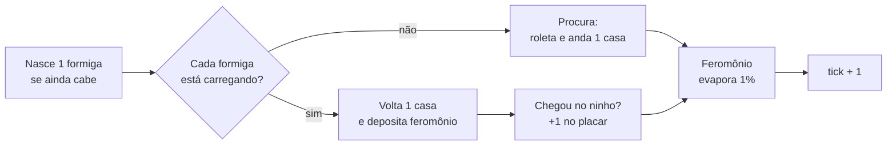

<h1 align="center">🐜 Colônia de Formigas-Robô</h1>

<p align="center">
  <b>Formigas cegas, regras simples e um caminho curto que ninguém planejou.</b>
</p>

<p align="center">
  
  
  
  
</p>

<p align="center">
  
</p>

<p align="center"><sub>
  🟤 ninho &nbsp;·&nbsp; 🟢 comida &nbsp;·&nbsp; ⚫ formiga procurando &nbsp;·&nbsp; 🔴 formiga carregando comida &nbsp;·&nbsp; 🟧 trilha de feromônio
  <br>No tick 1800 o atalho do meio é fechado com paredes, e a colônia encontra a rota de cima sozinha.
</sub></p>

---

## 📌 Sobre o projeto

Cada formiga deste projeto é **cega**: ela só enxerga as 4 casas ao redor e não conhece o mapa. Mesmo assim, a colônia inteira acaba descobrindo um caminho curto entre o ninho e a comida.

O segredo é o **feromônio**. Quem acha comida volta ao ninho deixando cheiro pelo caminho, e as outras formigas tendem a seguir o cheiro mais forte. Caminhos curtos são percorridos mais vezes e ficam mais cheirosos; caminhos ruins são abandonados, e o cheiro deles **evapora**. Se o caminho for bloqueado, a colônia se adapta e acha outro.

O projeto tem três partes:

- **As formigas:** como cada uma decide o próximo passo, anda, pega e entrega comida.
- **O mundo e o relógio:** o mapa com paredes, ninho e comida, e a simulação que avança tick a tick.
- **O laboratório:** experimentos que testam hipóteses e comparam a colônia com o **BFS**, um algoritmo que conhece o mapa inteiro e dá o caminho ótimo.

> 💡 **A ideia central:** um comportamento inteligente da colônia surge de regras simples e locais de cada formiga.

---

## 🧠 Como as formigas funcionam

### A roleta: para onde ir

A cada tick, a formiga olha os vizinhos livres e sorteia um deles. Cada vizinho recebe um peso:

```
peso = (cheiro + 0.05) ^ alfa
```

- Mais cheiro dá mais chance, mas **nunca 100%**, e o `0.05` garante que uma casa sem cheiro ainda possa ser escolhida. É isso que permite explorar caminhos novos.
- O **alfa** é a confiança no rastro: com `0`, todos os pesos ficam iguais e ela anda ao acaso; com `2`, segue forte o cheiro.
- Ela não volta para a casa de onde acabou de sair, para não ficar indo e voltando.

### O diário: como voltar sem conhecer o mapa

Enquanto procura, a formiga anota cada casa num **diário** (uma lista de posições). Se pisa numa casa que já está no diário, ela andou em círculo, e o círculo é apagado.

```
diário: N → A → B → C → D   e ela anda para B
diário: N → A → B           (o círculo B → C → D sumiu)
```

Ao achar comida, ela volta **lendo o diário de trás para frente**, uma casa por tick.

### O feromônio: como a colônia escolhe o atalho

Na volta, a formiga deposita em cada casa `40 / tamanho do caminho`. **Caminho curto deixa mais cheiro por casa** e ainda é percorrido mais vezes, então a colônia converge para ele. O cheiro evapora 1% por tick: trilhas que ninguém reforça somem em poucas centenas de ticks.

### Dois tipos de formiga

| | Operária | Exploradora |
|---|---|---|
| Como escolhe | Roleta pelo cheiro | Ao acaso, ignora o cheiro |
| Papel na colônia | Aproveita as trilhas boas | Curiosidade: acha caminhos novos |

A classe `Formiga` é **abstrata**: procurar, voltar e o diário são iguais para todas. As filhas só mudam o método `escolherProximaCelula`, e isso é **polimorfismo**.

### O que acontece em 1 tick



O `Ambiente` guarda o mapa e valida as regras do mundo: por exemplo, recusa uma parede que isolaria o ninho da comida (confere com o BFS e desfaz a parede). O `Simulador` usa um único `Random` com **semente fixa**, então cada experimento pode ser repetido com exatamente o mesmo resultado.

---

## 🔬 Laboratório: resultados

<!-- Samuel: tabela com varias sementes e o experimento das exploradoras -->

Mapa **"Duas Rotas"** (26 × 44), 120 formigas, 3000 ticks, semente 42:

| Experimento | Hipótese | Resultado |
|---|---|---|
| Confiança no rastro | A colônia que segue o feromônio coleta mais | alfa 0: **89** · alfa 2: **544** |
| Atalho fechado | A colônia acha outra rota quando o atalho fecha | **544** antes · **404** depois de fechar |
| Formigas contra o BFS | A média das viagens fica acima do mínimo | BFS: **31** passos · formigas: **62,5** |

*Em andamento: resultados com várias sementes e o experimento das exploradoras.*

---

## 🗂️ Organização do código

```
src/
├── modelo/        Posicao, TipoCelula, Ambiente, Mapas, MapaFeromonio
├── agentes/       Formiga (abstrata), FormigaOperaria, FormigaExploradora
├── algoritmos/    BuscaEmLargura (BFS)
├── simulacao/     Simulador
├── experimentos/  Experimento (abstrata) e um experimento por hipótese
├── excecoes/      FonteEsgotadaException, CaminhoBloqueadoException, PosicaoInvalidaException
└── app/           Main (tela do mapa) e Laboratorio (experimentos)
```

---

## ▶️ Como rodar no seu computador

Precisa do **Java 21** ou mais novo. Na pasta do projeto:

**Windows (PowerShell)**
```powershell
javac -encoding UTF-8 -d out (Get-ChildItem -Recurse -Filter *.java src).FullName
java -cp out app.Main
java -cp out app.Laboratorio
```

**Linux / macOS**
```bash
javac -encoding UTF-8 -d out $(find src -name "*.java")
java -cp out app.Main
java -cp out app.Laboratorio
```

- `app.Main` roda 3000 ticks e desenha o mapa no console.
- `app.Laboratorio` roda os experimentos e imprime os resultados.

Legenda do mapa no console: `#` parede · `N` ninho · `C` comida · `f` formiga procurando · `o` formiga carregando · `*` cheiro forte · `:` cheiro médio · `.` sem cheiro.

---

## 👥 Integrantes

<p>
  <a href="https://github.com/enzoemanuelgl"></a>
  &nbsp;&nbsp;<b>ENZO EMANUEL</b> &nbsp;·&nbsp; <sub>as formigas, o feromônio e o BFS</sub>
</p>
<p>
  <a href="https://github.com/dedemandias"></a>
  &nbsp;&nbsp;<b>ANDRÉ DIAS</b> &nbsp;·&nbsp; <sub>o ambiente, os mapas e o simulador</sub>
</p>
<p>
  <a href="https://github.com/samuel000px"></a>
  &nbsp;&nbsp;<b>SAMUEL VASCONCELOS</b> &nbsp;·&nbsp; <sub>a tela e o laboratório de experimentos</sub>
</p>
