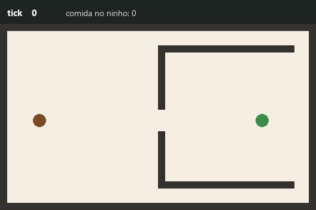
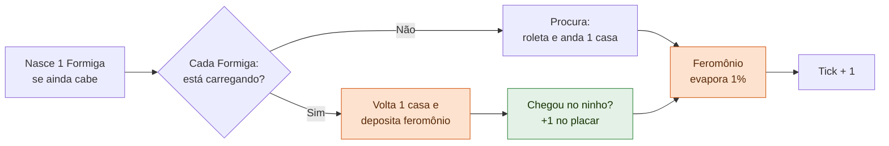

<h1 align="center">🐜 Colônia de Formigas-Robô</h1>

<p align="center">
  <i>Formigas cegas, regras simples e um caminho curto que ninguém planejou.</i>
</p>

<p align="center">
  
  
  
  
</p>

<p align="center">
  
</p>

<p align="center"><sub>
  🟤 Ninho &nbsp;·&nbsp; 🍓 Comida &nbsp;·&nbsp; ⚫ Operária &nbsp;·&nbsp; 🔵 Exploradora &nbsp;·&nbsp; 🟧 Trilha de Feromônio
  <br><br>As formigas levam pedacinhos da comida até o ninho, e ela vai sendo comida aos poucos.
  <br>No tick 1800, o atalho do meio é fechado com paredes, e a colônia encontra sozinha outra rota.
</sub></p>

---

## 📌 Sobre o Projeto

Cada formiga deste projeto é **cega**: ela só enxerga as 4 casas ao redor e não conhece o mapa. Mesmo assim, a colônia inteira acaba descobrindo um caminho curto entre o ninho e a comida.

O segredo é o **feromônio**. Quem acha comida volta ao ninho deixando cheiro pelo caminho, e as outras formigas tendem a seguir o cheiro mais forte. Caminhos curtos são percorridos mais vezes e ficam mais cheirosos; caminhos ruins são abandonados, e o cheiro deles **evapora**. Se o caminho for bloqueado, a colônia se adapta e acha outro.

O projeto tem três partes:

- 🐜 **As Formigas:** como cada uma decide o próximo passo, anda, pega e entrega comida.
- 🗺️ **O Mundo e o Relógio:** o mapa com paredes, ninho e comida, e a simulação que avança tick a tick.
- 🔬 **O Laboratório:** experimentos que testam hipóteses e comparam a colônia com o **BFS**, um algoritmo que conhece o mapa inteiro e dá o caminho ótimo.

> 💡 **A Ideia Central:** um comportamento inteligente da colônia surge de regras simples e locais de cada formiga.

## 🧠 Como as Formigas Funcionam

### 🎯 A Roleta: Para Onde Ir

A cada tick, a formiga olha os vizinhos livres e sorteia um deles. Cada vizinho recebe um peso:

```
peso = (cheiro + 0.02) ^ alfa
```

- Mais cheiro dá mais chance, mas **nunca 100%**, e a base `0.02` garante que uma casa sem cheiro ainda possa ser escolhida. É isso que permite explorar caminhos novos.
- O **alfa** é a confiança no rastro: com `0`, todos os pesos ficam iguais e ela anda ao acaso; com `2`, segue forte o cheiro.
- Ela não volta para a casa de onde acabou de sair, para não ficar indo e voltando.

### 📖 O Diário: Como Voltar Sem Conhecer o Mapa

Enquanto procura, a formiga anota cada casa num **diário** (uma lista de posições). Se pisa numa casa que já está no diário, ela andou em círculo, e o círculo é apagado.

```
Diário: N → A → B → C → D   e ela anda para B
Diário: N → A → B           (o círculo B → C → D sumiu)
```

Ao achar comida, ela volta **lendo o diário de trás para frente**, uma casa por tick.

### 🟧 O Feromônio: Como a Colônia Escolhe o Atalho

Na volta, a formiga deposita em cada casa:

```
depósito = 50 / tamanho do caminho ^ 1,5
```

**Caminho curto deixa mais cheiro por casa** e ainda é percorrido mais vezes, então a colônia converge para ele. O expoente `1,5` dá ainda mais peso à distância: um caminho com metade do tamanho deixa cerca de **2,8 vezes** mais cheiro por casa. O cheiro evapora 1% por tick: trilhas que ninguém reforça somem em poucas centenas de ticks.

> 🧪 **Por que esses números?** A base `0.02` e o depósito `50 / tamanho^1,5` foram escolhidos testando mais de **70 mil simulações** (várias bases, fórmulas de depósito, sementes e cenários, incluindo abrir e fechar o atalho no meio). Em média, comparados com a versão anterior (`0.05` e `40 / tamanho`), eles trazem **64% mais comida**, deixam o caminho usado mais curto e fazem a colônia trocar melhor para um atalho que aparece depois.

### 🐜 Dois Tipos de Formiga

| | Operária | Exploradora |
|---|---|---|
| **Como Escolhe** | Roleta pelo cheiro | Ao acaso, ignora o cheiro |
| **Papel na Colônia** | Aproveita as trilhas boas | Curiosidade: acha caminhos novos |

A classe `Formiga` é **abstrata**: procurar, voltar e o diário são iguais para todas. As filhas só mudam o método `escolherProximaCelula`, e isso é **polimorfismo**.

### ⏱️ O Que Acontece em 1 Tick



O `Ambiente` guarda o mapa e valida as regras do mundo: por exemplo, recusa uma parede que isolaria o ninho da comida (confere com o BFS e desfaz a parede). O `Simulador` usa um único `Random` com **semente fixa**, então cada experimento pode ser repetido com exatamente o mesmo resultado.

## 🔬 Laboratório: Resultados

<!-- Samuel: tabela com varias sementes e o experimento das exploradoras -->

Mapa **"Duas Rotas"** (26 × 44) · 120 formigas · 3000 ticks · semente 42

| Experimento | Hipótese | Resultado |
|---|---|---|
| **Confiança no Rastro** | A colônia que segue o feromônio coleta mais | Alfa 0: **89** · Alfa 2: **747** |
| **Atalho Fechado** | A colônia acha outra rota quando o atalho fecha | Antes: **747** · Depois de fechar: **686** |
| **Formigas contra o BFS** | A média das viagens fica acima do mínimo | BFS: **31** passos · Formigas: **70,1** |

> ⏳ **Em Andamento:** resultados com várias sementes e o experimento das exploradoras.

## 🗂️ Organização do Código

```
src/
├── modelo/        Posicao, TipoCelula, Ambiente, Mapas, MapaFeromonio
├── agentes/       Formiga (abstrata), FormigaOperaria, FormigaExploradora
├── algoritmos/    BuscaEmLargura (BFS)
├── simulacao/     Simulador
├── experimentos/  Experimento (abstrata) e um experimento por hipótese
├── excecoes/      FonteEsgotadaException, CaminhoBloqueadoException, PosicaoInvalidaException
├── app/           Main (tela do mapa) e Laboratorio (experimentos)
└── naopoo/        Visualizacao (tela gráfica ao vivo, extra)
```

## ▶️ Como Rodar no Seu Computador

Precisa do **Java 21** ou mais novo. Na pasta do projeto:

**🪟 Windows (PowerShell)**
```powershell
javac -encoding UTF-8 -d out (Get-ChildItem -Recurse -Filter *.java src).FullName
java -cp out app.Main
java -cp out app.Laboratorio
java -cp out naopoo.Visualizacao
```

**🐧 Linux / 🍎 macOS**
```bash
javac -encoding UTF-8 -d out $(find src -name "*.java")
java -cp out app.Main
java -cp out app.Laboratorio
java -cp out naopoo.Visualizacao
```

- `app.Main`: roda 3000 ticks e desenha o mapa no console.
- `app.Laboratorio`: roda os experimentos e imprime os resultados.
- `naopoo.Visualizacao`: abre a **tela gráfica** com a simulação ao vivo. Dá para trocar de mapa, colocar paredes e comida com o mouse, abrir e fechar o atalho e ajustar a velocidade, o número de formigas, as exploradoras, a confiança (alfa) e a evaporação.

**Legenda do Mapa no Console:** `#` Parede · `N` Ninho · `C` Comida · `f` Formiga Procurando · `o` Formiga Carregando · `*` Cheiro Forte · `:` Cheiro Médio · `.` Sem Cheiro

## 👥 Integrantes

<p>
  <a href="https://github.com/enzoemanuelgl"></a>
  &nbsp;&nbsp;<b>ENZO EMANUEL</b> &nbsp;·&nbsp; <sub>As Formigas, o Feromônio e o BFS</sub>
</p>
<p>
  <a href="https://github.com/dedemandias"></a>
  &nbsp;&nbsp;<b>ANDRÉ DIAS</b> &nbsp;·&nbsp; <sub>O Ambiente, os Mapas e o Simulador</sub>
</p>
<p>
  <a href="https://github.com/samuel000px"></a>
  &nbsp;&nbsp;<b>SAMUEL VASCONCELOS</b> &nbsp;·&nbsp; <sub>A Tela e o Laboratório de Experimentos</sub>
</p>
